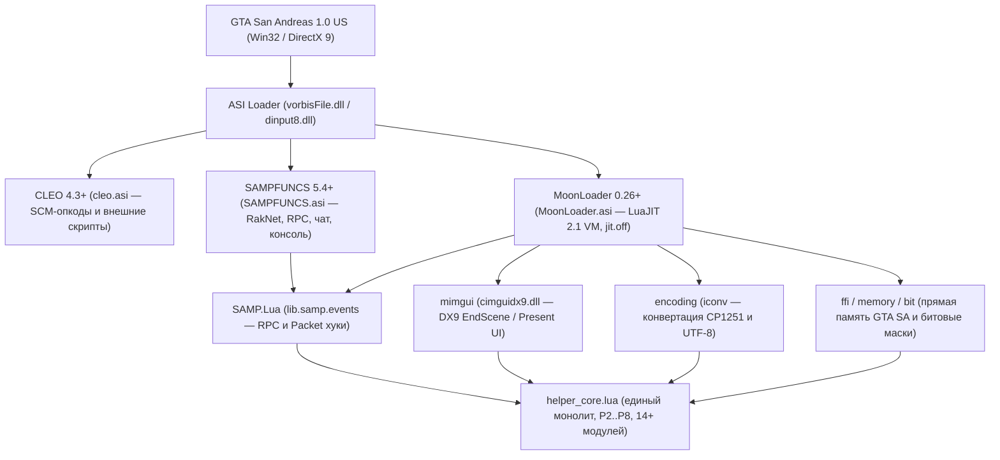
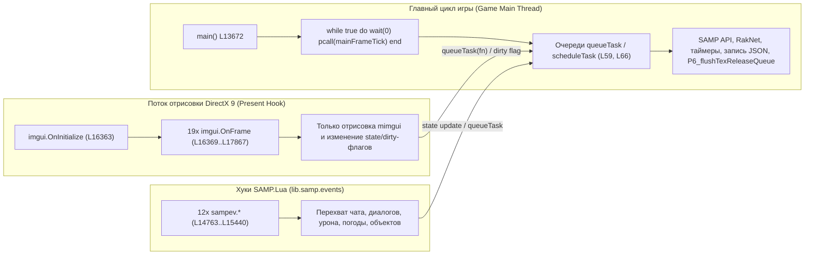
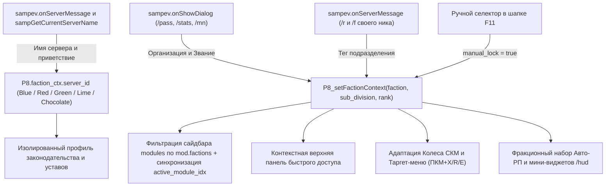
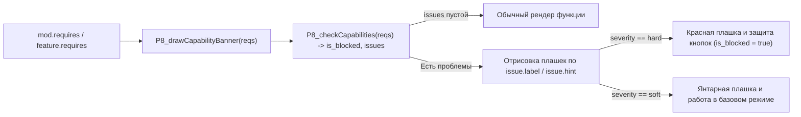

# Universal Helper Platform — Архитектура стека и платформы (v2.7 → v3.0)

> **Статус документа:** Актуальная архитектура стека GTA SA / SA-MP / MoonLoader / LuaJIT / mimgui / SAMP.Lua и целевой проект **v3.0 (Фракционно-адаптивная платформа + плашки зависимостей `ENV_CAPS`)**.
> **Текущая версия ядра:** `helper_core.lua` **v2.7** (commit `25b14a9`, `17 921` строк, `814 687` байт, `CP1251 + CRLF`).
> **Целевая среда запуска:** `E:\ukraine_rp_runtime\moonloader\helper_core.lua` (`MoonLoader v.026.5-beta`, `SAMPFUNCS v5.7.1 rel.25 (SA-MP 0.3.7-R1)`, `mimgui / cimguidx9.dll`, `SAMP.Lua`).

---

## 1. Стек технологий и жизненный цикл (Runtime Stack)

`Universal Helper Platform` работает внутри 32-битного Win32-процесса `gta_sa.exe` поверх цепочки ASI-инъекторов и DirectX 9 хуков. Понимание слоёв стека критично, потому что ошибка на одном уровне (например, вызов SAMP API из DX9 Present-потока или обращение к `GImGui` до создания рендерера) ведёт к мгновенному нативному крашу (`0xC0000005`).



### Двухфазная модель исполнения (Main Loop vs DX9 Present)

В MoonLoader код скрипта реально выполняется в **двух разных контекстах**, и их смешивание — главный источник нативных вылетов:



**Главное правило границы потоков:** внутри `imgui.OnFrame` и `drawSettings()` **запрещены** прямые вызовы `sampSendChat`, `sampSendDialogResponse`, `getCharCoordinates`, `lua_thread.create`, `setClipboardText`, звук/CLEO/`memory.write`, запись на диск и немедленный `imgui.ReleaseTexture`. Замыкания `queueTask(fn)` / `scheduleTask(delay_ms, fn)` создаются **только внутри сработавших веток** (`if imgui.Button(...) then`), а не на каждый кадр, либо сбрасываются dirty-флаги, которые отрабатывает `mainFrameTick()` (L14030) и вынесенный из него `P8_tick()` (чтобы не раздувать локалы `mainFrameTick`, у которой уже `62/180`).

---

## 2. Карта текущей архитектуры ядра (v2.7)

Ядро `helper_core.lua` организовано как самодостаточный однофайловый скрипт (нулевая сложность установки для игрока: один файл в `moonloader/`), структурированный через реестр модулей и глобальные таблицы фаз:

### 2.1. Базовые щиты и зависимости ядра
- **Заголовок и защита VM:** `jit.off()` (L28) отключает трассирующий JIT-компилятор LuaJIT, устраняя нестабильность при FFI-вызовах из DX9 хуков.
- **Thread GC Protection Shield (`__thread_anchor_pool`, L39–L45):** оборачивает `lua_thread.create`, удерживая ссылки на корутины, чтобы деструктор `MoonLoader.asi` не ронял игру на `luaL_unref` (`0x6AE877D6` / `0x643877D6`).
- **Очереди задач (`queueTask` L59, `scheduleTask` L66):** перебрасывают действия из UI и RPC в безопасный кадр `mainFrameTick()`, предотвращая краш `0x6AE877F1`.
- **Подключаемые библиотеки:** `mimgui` (L129 — в v3.0 оборачивается в `pcall` на случай отсутствия, с резервным предупреждением в чат/лог), `ffi` (L130), `lib.samp.events` (L164), `encoding` (L165, CP1251 и UTF-8), `json` (L167, опциональный `pcall` со встроенным pure-Lua парсером/сериализатором).
- **Низкоуровневый доступ (`memory` / `bit`):**
  - Погода и время (L15648–L15659): `0xC81320` (погода), `0xB70153` (часы), `0xB70152` (минуты), `0xB70158` (тик часов).
  - Стробоскопы (L15782–L15797): битовая маска повреждений фар через `bit.band` / `bit.bor`.
  - Проверка двигателя в турбо-круизе `P1_isCarEngineOn` (L15886–L15888): `carPtr + 0x428`, бит `0x10`.
  - **Выявленный пробел v2.7 (закрывается в v3.0 через `ENV_CAPS`):** `memory` используется в стробоскопах и проверке двигателя без безопасного `local ok_mem, mem_lib = pcall(require, 'memory')` в шапке (L15782/L15886 предполагают наличие `memory`).

### 2.2. Пространства имён и бюджет LuaJIT
Чтобы никогда не упереться в жёсткие лимиты байткода LuaJIT 2.1 (**200 локалов** на прототип, **60 upvalues** на замыкание), состояние разделено по глобальным таблицам фаз:
- `P2` (L2834) — RP-движок, колесо СКМ, таргет-меню, бинды сценариев.
- `P3` (L2850) — Лектор и связанные настройки.
- `P4` (L2909) — Фракционный модуль (`P4_drawFactionUI` L10623) и кодекс.
- `P5` (L3091) — Визуал, свободная камера `/cam` (`P5_enterFreeCam` L11469).
- `P6` (L3128) — Конструктор `/location` (522 предмета, `P6_quatToEuler` L12303, `P6_flushTexReleaseQueue` L12926, ряд/забор и пресеты сцен).
- `P7` (L3790) — Темы ImGui (`applyCustomStyle` L16269), трекер цен `/price`, патруль `/patrol` (38 зон SA + сектора `A-1..H-8`).
- **`P8` и `ENV_CAPS` (зарезервированы под v3.0):** контекст фракции, диагностика окружения, модуль МО/Армия, серверные профили и state-machine подтверждённого RP.

**Текущий запас по лимитам LuaJIT (по `python harness/run.py --snapshot`):**
- `top_locals = 48 / 150`
- `max_active = 49 / 180`
- `max_fn_locals = 62 / 180` (`mainFrameTick`)
- `max_upvals = 10 / 45`
- **Жёсткое правило:** ноль новых `local` на верхнем уровне файла — все новые состояния строго в `P8.*` / `ENV_CAPS.*`.

### 2.3. Реестр модулей (`14` в v2.7 → `15` в v3.0; `modules[i]`, `active_module_idx` L442, F11 L16369–L16510)
| # | ID модуля | Строка | Назначение в v2.7 |
|---|---|---|---|
| 1 | `gnews` | L7351 | Гос. новости (подача по расписанию/шаблонам) |
| 2 | `autocall_db` | L7360 | Автообзвон и база телефонов игроков |
| 3 | `auto_ad` | L7567 | Авто-реклама по таймеру и шаблонам |
| 4 | `mm_editor` | L7705 | MM Editor / AutoEdit (`/edit`, 1971 правило) |
| 5 | `auto_rp` | L7713 | Авто-РП отыгровки перед командами |
| 6 | `vehicle_visuals` | L7760 | Стробоскопы, круиз, погода/время, скин, `/cam` |
| 7 | `keybinds` | L7933 | Бинды клавиш на команды чата |
| 8 | `commands_guide` | L8084 | Справочник команд Advance RP |
| 9 | `rp_engine` | L8140 | RP-движок: бинд-сценарии, колесо СКМ, таргет-меню |
| 10 | `smi_tools` | L8182 | Инструменты СМИ (эфиры, викторины, автообъявления) |
| 11 | `qol_tools` | L8303 | QoL: `/hud`, фильтр чата, `/clog`, `/price`, темы/масштаб, экспорт |
| 12 | `lecturer` | L8790 | Лектор (построчные лекции и речи) |
| 13 | `faction_tools` | L8798 | Фракции (`P4_drawFactionUI` L10623: МВД `/suw`, МЗ `/medui`, Damage Informer `/dmglog`, Патруль `/patrol`) |
| 14 | `location_builder` | L8807 | `/location` конструктор объектов (522 предмета, ряд/забор, сцены) |

### 2.4. Ключевые точки входа, 12 хуков `sampev` и 13 JSON-конфигов
- **Ключевые функции:** `main()` (L13672), `mainFrameTick()` (L14030), `P1_getImguiInputState()` (L11530), `evaluateChatFilter()` (L14566), `applyCustomStyle()` (L16269), `onScriptTerminate()` (L17885).
- **12 хуков `sampev`:** `onSendChat` (L14763), `onSendCommand` (L14785), `onSetPlayerTime` (L14946), `onSetWeather` (L14952), `onServerMessage` (L14959), `onPlayerJoin` (L15176), `onPlayerQuit` (L15192), `onShowDialog` (L15206), `onSendGiveDamage` (L15329), `onSendTakeDamage` (L15333), `onEnterEditObject` (L15336), `onSendEditObject` (L15440).
- **19 окон `imgui.OnFrame`** (L16369–L17867) + `imgui.OnInitialize` (L16363).
- **Хранение данных (13 JSON-файлов + Export v2):**
  - `moonloader/config/`: `helper_db.json` (L447), `helper_mm_rules.json` (L448), `helper_settings.json` (L449), `helper_lecturer.json` (L2865), `helper_codex.json` (L2910), `helper_locations.json` (L3129), `helper_loc_blueprint.json` (L3697), `helper_market.json` (L3797), `helper_export.json` (L3894).
  - `%LOCALAPPDATA%` (`getFolderPath(0x1C)`, с fallback в `config/`): `helper_ad_history.json` (L600), `helper_edit_corrections.json` (L638), `helper_rp_settings.json` (L5495), `helper_blacklist.json` (L6537).
- **Agent Harness (внутри репозитория):**
  - `harness/run.py` + `harness/lua_audit_core.py` + `harness/suites/test_phase2..6.py`: полный статический и поведенческий верификатор (`python harness/run.py`), быстрый gate (`--fast`, `--fast --json`), живая телеметрия архитектуры (`--snapshot`) и проверка деплоя (`--deploy-check`).
  - `harness/patch_helper.py`: безопасное чтение/поиск CP1251 (`--read`, `--search`) и атомарный патчинг (`load_helper`, `replace_once`, `save_helper` с автооткатом при провале `--fast`).
  - `.agents/hooks.json` (`cp1251_guard.py` + `stop_verify.py`): активная блокировка UTF-8 правок на `helper_core.lua` и автоматический прогон `--fast` при его изменении.

---

## 3. Каталог инвариантов и краш-ловушек стека (12 обязательных правил)

1. **Кодировка CP1251 + CRLF (`\r\n`):** `helper_core.lua` хранится строго в Windows-1251 с CRLF для корректного вывода кириллицы в чат SA-MP. Запрещено редактировать его UTF-8 инструментами (`edit_file`) — только Python-скриптами с `.decode("cp1251")` / `.encode("cp1251")` и raw-строками `r'''...'''`.
2. **Лимиты LuaJIT 2.1 (`200` locals / `60` upvalues):** все новые модули и состояния добавляются в глобальные таблицы (`P8`, `ENV_CAPS`), без новых верхнеуровневых `local`. Новую покадровую логику v3.0 выносить в `P8_tick()` (вызывается из `mainFrameTick`), чтобы не расти по локалам `mainFrameTick` (`62/180`).
3. **Отключённый JIT (`jit.off()`, L28):** сохранять обязательно; включённый JIT ломает стабильность FFI-вызовов в DX9.
4. **Щит сборщика мусора корутин (`__thread_anchor_pool`, L39–L45):** любая новая корутина обязана идти через обёрнутый `lua_thread.create` (защита от `0x6AE877D6` / `0x643877D6`).
5. **Запрет побочных эффектов в `OnFrame` (`0x6AE877F1`):** из `imgui.OnFrame` и `drawSettings()` нельзя напрямую звать `samp*`, `getCharCoordinates`, `lua_thread.create`, `setClipboardText`, звук/CLEO/`memory.write` и запись файлов — замыкания `queueTask()` / `scheduleTask()` создаются строго внутри веток срабатывания (`if imgui.Button(...) then`), либо выставляются dirty-флаги.
6. **Ленивая инициализация `GImGui` (`0xC0000005 at 0x6E0A6BFE`):** в `mimgui` контекст `renderer` равен `nil` до первого активного кадра `OnFrame`. Вызов `imgui.GetIO()` вне `OnFrame`/`OnInitialize` без проверки `imgui.IsInitialized()`, `imgui.GetRenderer()` (`not r.lost`) и `imgui.SwitchContext()` гарантированно роняет `cimguidx9.dll` даже под `pcall`. Всегда использовать `P1_getImguiInputState()` (L11530), а `require('mimgui')` в начале скрипта защитить через `pcall` с выводом ошибки в чат/лог.
7. **Усечение нулевого байта в `encoding` (`iconv`) и двойная перекодировка:** `u8"A\0B\0"` обрезается на первом `\0`. Для `imgui.Combo` / `imgui.ListBox` нулевые байты **всегда** выносить наружу: `u8"A" .. "\0" .. u8"B" .. "\0"`, а перевод CP1251 в UTF-8 через `u8(...)` выполнять ровно один раз на границе UI.
8. **Безопасные вызовы `mimgui`:** только `imgui.TextUnformatted(...)` (не `Text`/`TextColored` с `%`); нечётные размеры `imgui.new.char[N]` + `ffi.sizeof(buf)`; `imgui.PushIDStr`/`Int`/`Ptr` (нет `imgui.PushID`); безусловный `imgui.End()` после `Begin`, парные `BeginChild`/`EndChild` и `Push*`/`Pop*`; на пассивных HUD-окнах — `HideCursor = true` + флаг `NoInputs`.
9. **Отложенное освобождение DX9-текстур и безопасное завершение:** освобождать текстуры только вне кадра отрисовки через `P6_flushTexReleaseQueue()` (L12926); в `onScriptTerminate()` (L17885) всегда проверять `not quitGame and imgui.IsInitialized()`.
10. **Сдвиг возвращаемых значений под `pcall`:** `pcall` добавляет первым значением `ok` — например, `local ok, res, pid = pcall(sampGetPlayerIdByCharHandle, ped)` и `local ok, res, x, y, z = pcall(getObjectCoordinates, obj)`. Никогда не вызывать `wait()` внутри `pcall`, и держать `mainFrameTick()` вынесенным из цикла `while true do`.
11. **Запрещённые несуществующие API и затенение:** не использовать `isSampPauseMenuActive` (нужно `isPauseMenuActive`), `sampGetCurrentDialogStyle` (нужно `sampGetCurrentDialogType`), `isThisModelABike`/`isThisModelATrain` (нужно `NON_AUTO_MODELS` + `isThisModelACar`), `getObjectRotation` (нужно `getObjectQuaternion` + `P6_quatToEuler`), `setCarLightDamageStatus`; не затенять встроенные функции MoonLoader (`isCarEngineOn` → `P1_isCarEngineOn`). В `sampev.onServerMessage` `evaluateChatFilter()` обязан выполняться **до** `/clog`, звуков и парсеров; перед `return false` в `/find` отправлять `sampSendDialogResponse(dialogId, 0, -1, "")` (4-й аргумент — `""`, а не `-1`).
12. **Математика вращений GTA:SA (`Rz*Rx*Ry`):** для конвертации кватернионов объектов в углы Эйлера используется исключительно инверсия `CMatrix::SetRotate` в `P6_quatToEuler()` (L12303).

---

## 4. Целевая архитектура v3.0 — Фракционно-адаптивная платформа

Главная проблема «комбайнов» для SA-MP — на экран вываливаются сразу все модули (в v2.7 их `14`, в v3.0 — `15` с добавлением `army_tools`): боец в армии видит кнопки `/edit` СМИ, розыск МВД и лечение МЗ. В **v3.0** интерфейс и контекстные меню **автоматически подстраиваются под текущую фракцию игрока**, оставляя на виду только релевантные инструменты, при этом любая функция остаётся доступной в один клик через переключатель **«Показать все модули»**.

### 4.1. Модель контекста фракции (`P8.faction_ctx`)

```lua
P8.faction_ctx = {
    active_faction   = "civ",       -- "mo" | "mvd" | "mz" | "smi" | "gov" | "crime" | "civ"
    sub_division     = "",          -- напр. "СВ" | "ВВС" | "ВМФ" для "mo"; "ЛСПД"|"СФПД"|"ЛВПД"|"ФБР" для "mvd"
    rank_name        = "",          -- звание / должность из /pass или /stats
    rank_num         = 0,
    server_id        = "unknown",   -- "blue" | "red" | "green" | "lime" | "chocolate" | "unknown"
    auto_detect      = true,        -- автоопределение из диалогов и рации
    show_all_modules = false,       -- 1-клик в шапке F11, чтобы временно показать все 14/15 модулей
    manual_lock      = false,       -- если игрок вручную выбрал профиль, не перезаписывать случайно
}
```

### 4.2. Конвейер автоопределения фракции и сервера



- **Автодетект без навязчивости и без ложных срабатываний:** основной источник — диалоги `/pass`, `/stats`, `/mn`. Рация `/r` и `/f` учитывается **только для сообщений от своего собственного ника** (никогда от `/d` или `/gnews`, где пишут чужие фракции!). Например, `Сухопутные войска` → `mo / СВ`, `Военно-воздушные силы` → `mo / ВВС`, `Военно-морской флот` → `mo / ВМФ`. При переключении фракции `active_module_idx` синхронизируется до рендера `imgui.OnFrame`, чтобы индекс не указывал на скрытую вкладку.
- **Ручной селектор в шапке `F11`:** выпадающий список `[Фракция: МО (Армия)]` + `[Подразделение: СВ]` + чекбокс `[Все модули]`. Выбор сохраняется в `helper_settings.json`.

### 4.3. Матрица видимости модулей по фракциям (`mod.factions`)

| Модуль (`id`) | `factions` (метаданные) | МО (Армия) | МВД / ФБР | МЗ | СМИ | Мэрия | Крайм | Гражд. |
|---|---|---|---|---|---|---|---|---|
| **`army_tools` (новый)** | `{"mo"}` | **Да (основной)** | — | — | — | — | — | — |
| `faction_tools` (`P4_drawFactionUI`: МВД/МЗ/Damage/Патруль) | `{"mvd", "mz"}` | — *(Damage перенесён в qol/army)* | **Да** | **Да** | — | — | — | — |
| `mm_editor` (`/edit`) | `{"smi"}` | — | — | — | **Да** | — | — | — |
| `smi_tools` (эфиры/викторины) | `{"smi"}` | — | — | — | **Да** | — | — | — |
| `gnews` (гос. новости) | `{"mo", "mvd", "mz", "smi", "gov"}` | Да (ст. состав) | Да | Да | Да | Да | — | — |
| `lecturer` (лекции/присяга) | `{"mo", "mvd", "mz", "smi", "gov"}` | **Пакет МО** | Пакет МВД | Пакет МЗ | Пакет СМИ | Пакет Мэрии | — | — |
| `auto_rp` (боевое / служебное RP) | `{"all"}` (фильтр пресетов) | Боевой/МО | Полиц./МВД | Мед./МЗ | СМИ | Мэрия | Крайм | Базовый |
| `rp_engine` (СКМ + Таргет-меню) | `{"all"}` (адаптация меню) | Контекст МО | Контекст МВД | Контекст МЗ | Контекст СМИ | Контекст Мэрии | Крайм | Гражд. |
| `vehicle_visuals` | `{"all"}` | Да | Да | Да | Да | Да | Да | Да |
| `keybinds` | `{"all"}` | Да | Да | Да | Да | Да | Да | Да |
| `commands_guide` | `{"all"}` (приоритет секции) | Сверху МО | Сверху МВД | Сверху МЗ | Сверху СМИ | Сверху Мэрия | Сверху Крайм | Общие |
| `qol_tools` (`/hud`, `/price`, `/dmglog`, темы) | `{"all"}` | Да | Да | Да | Да | Да | Да | Да |
| `location_builder` (`/location`) | `{"all"}` (приоритет пресетов) | Блокпост/Полигон | Оцепление | Медпункт | Студия | Трибуна | Сходка | Все |
| `autocall_db` | `{"smi", "civ", "gov"}` | Скрыт* | Скрыт* | Скрыт* | Да | Да | Скрыт* | Да |
| `auto_ad` | `{"smi", "civ", "crime"}` | Скрыт* | Скрыт* | Скрыт* | Да | Скрыт* | Да | Да |

*\* Любой скрытый модуль мгновенно появляется при включении галочки `Показать все модули` в шапке `F11`.*

### 4.4. Адаптация контекстных интерфейсов (не только сайдбар)
- **Верхняя панель быстрого доступа (`F11`):**
  - Для **МО (Армия):** `[Пост / Доклад]` `[Конвой БП]` `[ЧС / Тревога!]` `[Присяга / Лектор]` `[Устав МО]`. Никаких кнопок `/edit`, розыска или лечения.
  - Для **МВД / ФБР:** `[Патруль]` `[Розыск / УК]` `[Мегафон 10-55]` `[Штраф]` `[Кодекс]`.
  - Для **СМИ:** `[/edit AutoEdit]` `[Эфир]` `[Викторина]` `[Автообъявления]`.
- **Колесо СКМ и Таргет-меню (`ПКМ + X / R / E`):**
  - **МО (Армия):** «Потребовать документы (КПП)», «Предупреждение: покинуть охраняемую территорию», «Доложить о нарушителе в `/r`», «Передать аптечку/маску», «Отдать честь (анимация)».
  - **МВД / ФБР:** `/su`, `/cuff`, `/gotome`, `/frisk`, `/ticket`, `/pull`.
  - **МЗ:** `/heal`, осмотр, выдача медкарты.
  - **Гражданский / Крайм:** `/c`, `/sms`, обмен, быстрые фразы.
- **`/hud` мини-виджеты:** в режиме `mo` отображается таймер доклада на посту (`Пост КПП-1 | Доклад через 04:12`), статус конвоя БП и компактный Damage Informer (если включён), вместо патрульного счётчика МВД или счётчика `/edit` СМИ.

---

### 4.5. Детальный дизайн модуля МО / Армия (`army_tools`, приоритет №1)

Модуль проектируется с учётом реальной службы в **Сухопутных войсках (СВ)**, **ВВС** и **ВМФ** на Advance RP:

1. **Посты и дежурство (`P8.army.post`):**
   - Пресеты постов: `КПП-1`, `КПП-2`, `Вышка`, `Склад БП`, `Авианосец (Кит)`, `Ангар`, `Казарма` + свободный ввод.
   - Статусы обстановки: `Код 1 (спокойно)`, `Код 2 (подозрительная активность)`, `Код 3 (ЧС / нападение)`.
   - Настраиваемый интервал напоминания доклада (по умолчанию `10 мин`): обратный отсчёт в `/hud`, мягкий звуковой/визуальный сигнал и отправка отформатированного доклада в `/r` **по нажатию кнопки/хоткея** (без автоспама в AFK).
   - Настраиваемый формат доклада с переменными: `{tag}`, `{post}`, `{code}`, `{crew}`, `{zone}`, `{sector}`.
2. **Конвой и доставка БП (`P8.army.convoy`):**
   - Использует общую базу 38 районов San Andreas и секторов `A-1..H-8` (уже есть в `P7`).
   - 4 кнопки цикла: `Выехал за БП` → `Загрузился (Авианосец/Склад)` → `Возвращаюсь на базу` → `Разгрузился на складе`.
   - Счётчик рейсов/поставок за сессию (для отчёта на повышение).
3. **Тревога / ЧС на базе (`P8.army.alarm`):**
   - Горячая клавиша (1 или 2 клавиши) мгновенного доклада о ЧС в `/r` (или `/d`) с автоподстановкой текущей зоны SA и сектора.
   - Опциональный радар-триггер на рацию `/r` и `/d`: при словах «ЧС», «нападение», «прорыв», «код 3» — звуковой сигнал + всплывающий баннер в HUD (с антиспам-кулдауном 15 сек).
4. **Присяга, Устав МО, Правила КПП, Субординация:**
   - Встроенный фракционный пакет для `lecturer` (Присяга, лекция по субординации, правила поведения на КПП, правила конвоя) с настраиваемой задержкой строк.
   - Вкладка быстрого поиска по **Уставу МО** и кодам рации прямо внутри `army_tools`.
5. **Боевое Авто-РП + `/sp <cmd>` + Damage Informer:**
   - Набор армейских отыгровок (оружие, бронежилет, маска, рация, `/healme`, отдание чести) с **подтверждением сервера** (см. §4.6).
   - Команда **`/sp <команда>`** (например, `/sp healme`, `/sp mask`) — разовый обход Авто-РП в бою, чтобы не терять секунды на отыгровку.
   - Интеграция с уже существующим в v2.7 **Damage Informer** (`dmg_enabled`, `/dmglog`, хуки `sampev.onSendGiveDamage` L15329 и `sampev.onSendTakeDamage` L15333): выносится быстрый переключатель в `army_tools` (и `qol_tools`), с защитой от невалидного `playerId` (`65535` / падение / взрыв) до вызова `sampGetPlayerNickname`.
6. **Военные пресеты `/location`:**
   - 3 готовых пресета из проверенного каталога 522 объектов: **КПП / Блокпост**, **Стрельбище / Полигон**, **Строевой плац**.

---

### 4.6. Кросс-фракционные паттерны (вдохновлено PoliceHelper)

1. **Автоопределение сервера Advance RP и строгая изоляция профилей:**
   - При подключении определяется сервер (`sampGetCurrentServerName()` + приветствие в чате, а не только IP, чтобы не ломаться под прокси/VPN): `Blue`, `Red`, `Green`, `Lime`, `Chocolate`.
   - **Инвариант несмешивания:** законодательство (УК, АК/КоАП, ПК, ПДД, ФП) и уставы хранятся в изолированных серверных профилях (`P8.server_profiles[server_id]`). Материалы **Blue** (включая старый неразделённый `helper_codex.json` из v2.7) никогда не подставляются автоматически на Chocolate/Red/Green/Lime; для неполных профилей и `unknown` отображается явная плашка.
2. **State-Machine подтверждённого сервером RP (`P8.rp_pending`) + `/sp <cmd>`:**
   - Команды со сложной проверкой сервера (`/cuff`, `/gotome`, `/mask`, `/healme`, `/form`, `/gpsoff` и т. д.) не отправляют финальную `/me`-отыгровку вслепую сразу после ввода.
   - При отправке команды регистрируется запись `P8.rp_pending[key] = { patterns = {...}, on_confirm = fn, expires_at = os.clock() + 3.0 }`. Только при получении подтверждающего сообщения в `sampev.onServerMessage` отправляется завершающая отыгровка.
   - Ввод `/sp <cmd> [args]` в `sampev.onSendCommand` ставит `P8.rp_bypass_once = true` и переписывает команду возвратом `{ "/" .. inner }` (без повторного вызова `sampSendChat`, чтобы исключить гонку/реэнтерабельность хука).
3. **Устойчивая text-matched автоматизация (строго opt-in, по умолчанию ВЫКЛ):**
   - Получение боекомплекта/снаряжения на складе (МО / МВД), заправка, покупка еды, обновление маски.
   - **Принцип устойчивости:** перехват `sampev.onShowDialog` предварительно убирает цветовые теги `{RRGGBB}`, защищается от дублирующегося срабатывания на один и тот же `dialogId`, корректно учитывает `TABLIST_HEADERS` (`style == 5`, где первая строка — заголовок колонок, а не элемент `0`) и ищет нужную строку списка **по текстовому шаблону**, а не по хрупкому номеру строки.
4. **Press-to-Capture хоткеи (1 или 2 клавиши):**
   - Единый виджет захвата клавиш (`[Нажмите клавишу или Комбинацию...]`), поддерживающий одиночные клавиши и связки `Модификатор (Alt/Ctrl/Shift) + Клавиша` с проверкой `not sampIsChatInputActive() and not sampIsDialogActive() and not P1_getImguiInputState().want_text`.

---

## 5. Система диагностики окружения (`ENV_CAPS`) и UI-плашки зависимостей

Чтобы игрок **никогда** не сталкивался с «молча не работающей кнопкой» или крашем из-за отсутствующего плагина, вводится единый зонд окружения `ENV_CAPS` и переиспользуемые UI-плашки предупреждений.

### 5.1. Карта проверяемых зависимостей (`P8_probeEnvironment()`)

Зонд запускается **один раз при старте** в `main()` (до основного цикла) и кэширует результат в глобальной таблице `ENV_CAPS`:

| Ключ `ENV_CAPS` | Способ проверки в Lua / MoonLoader | Мин. версия | Какие функции зависят |
|---|---|---|---|
| `moonloader` | `getMoonloaderVersion()` (число, напр. `26` для `0.26`) | `0.26+` (`26`) | Всё ядро, `mimgui`, `SAMP.Lua` |
| `sampfuncs` | `isSampfuncsLoaded()` + безопасный парсинг `major.minor` из `tostring(getSampfuncsVersion())` | `5.4+` | RPC/пакеты, чат-хуки, рация, консоль, часть опкодов SAMP |
| `cleo` | `doesFileExist(getGameDirectory() .. "\\cleo.asi")` *(проверяет наличие файла на диске, а не точную версию бинарника/загрузку ASI)* | `4.3+` | Внешние CLEO-анимации, интеграции с CLEO-скриптами и расширенные опкоды |
| `samp_lua` | `pcall(require, 'lib.samp.events')` | актуальная | `/edit` AutoEdit, фильтр чата, автодетект фракции/сервера, подтверждённое Авто-РП, Damage Informer, `/location` edit-хуки |
| `mimgui` | `pcall(require, 'mimgui')` *(на старте: если нет — fallback в чат/лог)* | `1.7+` | Все 19 окон интерфейса |
| `mimgui_tex` | `type(imgui.CreateTextureFromFile) == "function"` | `mimgui` с DX9 | Превью PNG-иконок в `/location` (522 предмета) |
| `memory` | `pcall(require, 'memory')` (заменяет небезопасный глобал!) | встроенная | Стробоскопы, фиксация погоды/времени, проверка двигателя в турбо-круизе |
| `bit` | `type(bit) == "table" and type(bit.band) == "function"` | LuaJIT 2.1 | Битовые маски стробоскопов и флагов `CVehicle` |
| `json` | `pcall(require, 'json')` (`"native"` vs `"fallback"`) | опционально | Быстрый JSON (при отсутствии работает встроенный pure-Lua fallback — плашка не нужна) |

### 5.2. Схема объявления зависимостей в модулях и фичах (`requires`)

Каждый модуль или отдельная подфункция декларирует свои требования декларативно:

```lua
requires = {
    {
        id       = "sampfuncs",
        min      = 5.4,
        label    = "SAMPFUNCS 5.4+",
        severity = "hard", -- "hard" (функция недоступна) | "soft" (ограниченный режим)
        hint     = "Нужен для перехвата пакетов чата, диалогов и подтверждения RP.",
    },
    {
        id       = "cleo",
        min      = 4.3,
        label    = "CLEO 4.3+",
        severity = "soft",
        hint     = "Нужен для расширенных анимаций и совместимости с CLEO-модулями.",
    },
}
```

### 5.3. Переиспользуемый UI-виджет плашек `P8_drawCapabilityBanner(reqs)`



- **Формат текста на плашке (формируется динамически из `req.label` и `issue.cur_ver`):**
  - Если компонент не установлен:
    `[!] Для работы этой функции требуется <req.label> (сейчас не установлено — установите)`
  - Если установлена устаревшая версия:
    `[!] Для работы этой функции требуется <req.label> (установлена v<cur_ver> — обновите)`
- **Поведение виджета:**
  1. Принимает `reqs`, внутри вызывает `local is_blocked, issues = P8_checkCapabilities(reqs)` и отрисовывает для каждой проблемы цветную карточку (`BeginChild` с рамкой: красная для `hard`, янтарно-жёлтая для `soft`), используя исключительно `imgui.TextUnformatted` и `imgui.PushIDStr`.
  2. Показывает кнопку `[Что установить?]` (раскрывает `issue.hint`, куда именно положить `.asi` / библиотеку в папку игры).
  3. Возвращает `is_blocked` (`true`, если отсутствует `hard`-зависимость), позволяя модулю безопасно отключить/скрыть зависимые кнопки и никогда не доводить до nil-ошибки или краша.
- **Сводная панель «Диагностика стека»** в `F11 → Утилиты (QoL)`: единая таблица всех 9 компонентов стека с зелёными (`Установлено vX.Y`), жёлтыми (`Требуется обновление / опционально`) и красными (`Не установлено`) плашками.

---

## 6. Дорожная карта внедрения v3.0

1. **Этап 1 — Фундамент адаптивности и плашек зависимостей:**
   - Безопасный `pcall(require, 'memory')` + зонд `ENV_CAPS` (`P8_probeEnvironment`) + виджет `P8_drawCapabilityBanner(reqs)` + панель «Диагностика стека» в `qol_tools`.
   - Контекст `P8.faction_ctx`, автодетект из `/pass`, `/stats`, `/mn`, переключатель фракции/подразделения и галочка «Показать все модули» в шапке `F11`, фильтрация `modules[i]` по `factions`.
2. **Этап 2 — Модуль МО / Армия (`army_tools`) и подтверждённое RP:**
   - Вкладка `army_tools` (Посты КПП/Вышка/Склад/Авианосец + таймер докладов `/r`, Конвой БП с 38 зонами SA, Тревога/ЧС, Присяга/Устав МО в Лекторе, военные пресеты `/location`).
   - State-machine подтверждённого сервером Авто-РП (`P8.rp_pending`), обход **`/sp <cmd>`** и opt-in Damage Informer.
   - Адаптация Колеса СКМ, Таргет-меню и `/hud` под активную фракцию.
3. **Этап 3 — Серверные профили и продвинутая автоматизация:**
   - Автоопределение сервера Advance RP (`Blue`/`Red`/`Green`/`Lime`/`Chocolate`) + строго изолированные профили законодательства/уставов.
   - Press-to-capture хоткеи на 1 и 2 клавиши.
   - Opt-in text-matched автоматизация склада МО/МВД, заправки, еды и маски (строго ВЫКЛ по умолчанию).
